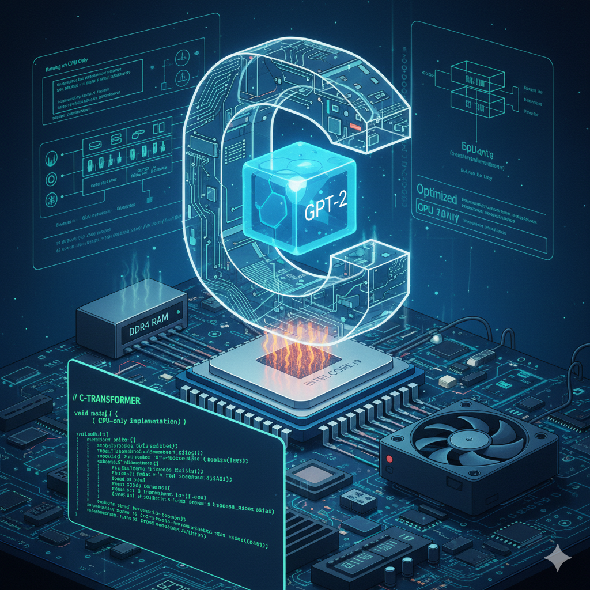

<div align="center">
  
</div>

# ⚠️ REPOSITORY WILL BE ARCHIVED SOON

**Status as of November 2025:**
- ✅ **Inference working perfectly** - Forward pass validated against PyTorch (diff < 1e-5)
- ⚠️ **Training has bugs** - Loss collapses to 0.0 after first step
- 📚 **Learning phase complete** - 10 weeks of deep transformer implementation experience
- 🔄 **Moving to next iteration** - Kernel-based DSL approach

**Why archiving:**
The codebase has become too complex (~15k lines monolithic) to efficiently debug remaining training issues. The inference engine works beautifully, but the right approach is to start fresh with lessons learned rather than debug bloated legacy code.

**What's next:**
A new repository with **kernel-level composition design** (similar to PyTorch/JAX) focusing on:
- 🧩 Modular kernels (each kernel = forward + backward in one file)
- 🎯 DSL-based computation graphs (not manual memory management)
- 💻 CPU-first optimization (x86, ARM, embedded systems)
- 🔍 Component-by-component validation (validate before moving forward)
- 🏗️ Multi-architecture support (GPT, Qwen, LLaMA from same kernels)

**Lessons learned** (documented in [`ARCHIVE_NOTICE.md`](ARCHIVE_NOTICE.md)):
1. Don't build everything before validating - validate each component immediately
2. Implement forward + backward together for each component, not all forward then all backward
3. PyTorch for training + C for inference is pragmatic for this repository. 
4. Numerical validation infrastructure is critical

**If you want to use this repository:**
- The **inference engine works perfectly** - see [`QUICKSTART_SQL_TRAINING.md`](QUICKSTART_SQL_TRAINING.md)
- Train models in PyTorch, export weights, run inference in optimized C
- See [`PYTORCH_TRAINING.md`](PYTORCH_TRAINING.md) for complete workflow

---

# 🚀 C-Transformers: Cache-Optimized Transformers in C

Building Embedded AI from Scratch — in C, on CPUs (x86 optimized), for Real-Time Autonomy.

[](https://antshiv.github.io/C-Transformer/)
[](https://github.com/antshiv/C-Transformer/actions/workflows/doxygen.yml)

This project is a pure C implementation of a GPT-style transformer model with:
- 🧠 Fully contiguous, single-block memory layout
- 📏 64-byte alignment for every tensor
- 🧱 Hugepage-backed allocations (2MB) to minimize TLB misses
- ⚙️ Inline memory bump allocator to track offsets precisely
- 🔧 Dry-run and allocation modes for profiling model memory capacity

---

## 📚 Documentation

**[📖 View Full API Documentation](https://antshiv.github.io/C-Transformer/)**

Comprehensive Doxygen documentation covering:
- Memory architecture and contiguous block design
- Token-level and head-level parallelism strategies
- Cache optimization techniques and alignment
- AVX-512 kernels and SIMD optimizations
- Function-by-function API reference with performance notes

**Generate docs locally:**
```bash
./run_doxygen.sh
# Open docs/html/index.html in your browser
```

---

## 📺 YouTube Series

This repo tracks my video series on building high-performance embedded AI systems.

▶️ **Series Playlist**: [Antshiv Robotics YouTube](https://www.youtube.com/@AntshivRobotics)  
🧵 Each video will have its own tagged release (`v1.0`, `v1.1`, etc.) that matches the code exactly.

---

## 🧠 Features

- Optimized layout for GPT-2-style transformers
- Clean C code with no external dependencies
- Command-line options to configure model dimensions:
  - `--layers`
  - `--dmodel`
  - `--ctx`
  - `--vocab`
- `--force` option to trigger actual memory allocation

---

## 🛠️ Build

```bash
git clone https://github.com/antshiv/C-Transformer
cd C-Transformer
chmod +x script.sh
./script.sh
```

## 🚀 Quick Start: Text Generation

**Prerequisites:**
```bash
pip3 install transformers --break-system-packages
```

**Simple workflow:**

```bash
# 1. Encode text to tokens
python3 encode.py "Hello, I am"

# 2. Run inference (all-in-one: encode → infer → decode)
python3 run.py "Hello, I am"

# 3. Decode output manually (if needed)
python3 decode.py output_*.txt
```

**Example output:**
```
📝 Input text: Hello, I am
📤 GENERATED: a student at the University of
📖 FULL TEXT: Hello, I am a student at the University of
```

## 🧪 Advanced Examples

```bash
# Dry run (estimate memory usage only)
./main --layers 12 --dmodel 384 --ctx 256 --vocab 32768

# Force allocation with hugepages
./main --layers 12 --dmodel 384 --ctx 256 --vocab 32768 --force

# Run inference with custom weights
python3 run.py "The future of AI" --weights gpt2_bump.weights --num-tokens 20
```

## 🔧 Usage Examples

```c
// Get embedded input slice
float *x = get_slice(M, core_id, M->embedded_input_offset, M->embed_dim);

// Token-parallel QKV access
float *qkv = get_slice(M, core_id, L->qkv_output_offset, 3 * M->embed_dim);

// Token loop
size_t token_count;
float *input = get_slice_and_len(M, core_id, M->embedded_input_offset, M->embed_dim, &token_count);
for (size_t t = 0; t < token_count; ++t) {
    float *vec = input + t * M->embed_dim;
    // Do work here...
}
```

## 📺 Related Video

This code is explained in detail in these video:

🎥 [The Memory Trick That Makes Multi-Core CPUs Fly for AI](https://youtu.be/Wv0_GLbODeI?si=z0pMmCuD_CjLE_Ao)
   [Advanced Memory Strategies for High-Performance AI Compute](https://youtu.be/pEhcvMRWhhU?si=uJ7HsiSAMCtQyxHG)
🧠 Covers false sharing, layout design, and core-sliced access

---

## 🔜 Next Generation Project

This repository will soon be archived. The next iteration with kernel-based DSL design will be at:

**[C-Kernel-Engine](https://github.com/antshiv/c-kernel-engine)** *(coming soon)*

Focus areas:
- 🧩 Modular kernel composition (like PyTorch/JAX)
- 🎯 DSL-based computation graphs
- 💻 CPU-first: x86, ARM, RISC-V, embedded systems
- 🔧 Multi-model support: GPT, Qwen, LLaMA
- 📊 Built-in profiling and debugging tools

See [`ARCHIVE_NOTICE.md`](ARCHIVE_NOTICE.md) for the full story and [`NEXT_STEPS.md`](NEXT_STEPS.md) for the roadmap.

---
© 2025 Antshiv Robotics. All rights reserved.

